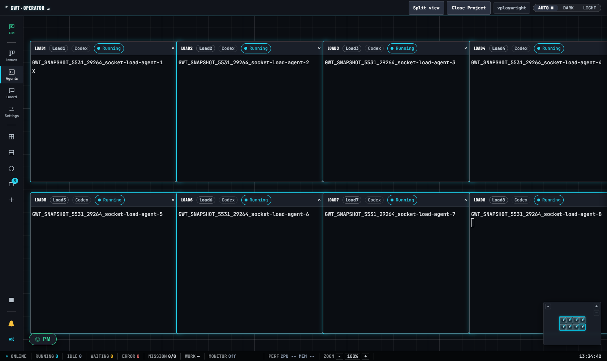
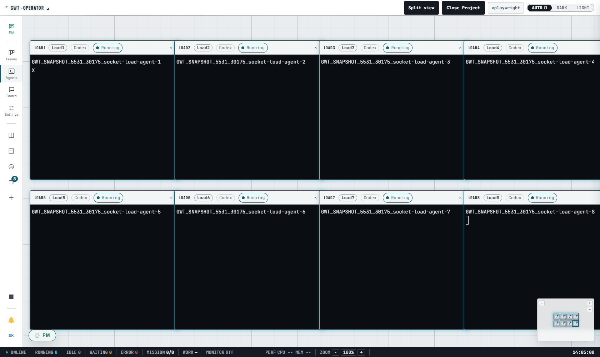

# Issue #5531: background WebSocket receive recovery

Owner: [Issue #5531](https://github.com/akiojin/gwt/issues/5531).
Parent: [SPEC #5390](https://github.com/akiojin/gwt/issues/5390).
This is a gwt runtime fix used when opening any project.

## Change

Budget deferral previously prepended every remaining entry separately. The
regression measures copied/shifted elements rather than runner wall time:
64 queued entries required 2,080 operations before the fix. One bulk prepend
requires 190, 766 and 3,070 operations for 64, 256 and 1,024 entries,
preserving ordering and the existing scheduler without adding a deque.

The receive queue now has a 2,048-entry cap. Overflow discards obsolete
traffic and requests authoritative snapshots. Native foreground recovery
also replaces the project connection: clearing the JavaScript queue alone
leaves native WebSocket frames ahead of fresh snapshots. Existing socket
identity and generation checks fence the abandoned transport. Recovery
survives a replacement that fails before OPEN, and leaves the retained
catalog connection in place.

After OPEN, recovery reloads mounted read surfaces and preserves drafts.
It does not replay sent mutations. An unconfirmed Board post remains
explicitly uncertain so the user can decide whether to retry. Settings
preserves explicit-save inputs while synchronizing autostart state.
Close-preview authority is invalidated when the transport is replaced.
Console and File Tree were retired upstream by Issue #4174 and stay retired.

## Measurement method

- Run `scripts/diagnostics/issue-5531-browser-check.ps1` with `-Label before`
  or `-Label after`, `-BackgroundMilliseconds 1800000`, and
  `-BaselineRef bc175f05a2b730775e1f5302b3af0d588ba4470a`.
  Both Operator themes run sequentially in real headed Chromium.
- Use this checkout's `target/debug/gwt.exe`, a fresh HOME, disabled PM and
  Issue Monitor, managed-hook fallback, and a recorded owned PID. Compare
  all ten measured frontend assets with the assets actually served.
- Minimize the native Chromium window. A private Playwright 1.49.1 copy
  disables its forced focus emulation, and Chromium's default background
  timer policy is restored. Every page observation asserts actual native
  `document.visibilityState === "hidden"`.
- Stream eight agent panes through a native loopback WebSocket (`ws@8.18.3`):
  terminal output and previews on a 50ms target tick, workspace state every
  20 ticks, and a 4,096-message burst every 600 ticks. Actual throughput is
  recorded; host scheduling may delay ticks. No accelerated clock is used.
- For the final after runs, a separate controller timer observes sender
  counters every 30 seconds. Renderer observations retain visibility, queue
  and long-task data independently. A delayed renderer query does not count
  as a pause in the sender. Each sender interval must advance ticks/frames,
  with no observation gap or unobserved tail over one minute.
- Freeze the backend snapshot revision before foregrounding. Require all
  eight fresh snapshots and one trusted native `X` key's backend echo within
  two seconds of the controller's native foreground request. Map that wall
  clock to `performance.timeOrigin`; a delayed visibility handler cannot
  reset the deadline. Compile the native window helper during setup.
- Record Long Tasks API maxima for the initial 0–2s and settled 2–4s windows.
  The latter must be below 200ms. Zero means no reported task of at least
  50ms, rather than zero CPU use. Foreground metrics are collected independently
  of snapshot/input recovery, which has a 15-second collection timeout.
- Background/timed observations use CDP evaluation and trusted key events
  to avoid Playwright trace DOM snapshots delaying the measured operation.
  Tracing remains enabled. Ordinary assertions and recovered screenshots
  remain outside the timed interval.

The comparison dispatcher is pinned to the baseline ref above, blob
`e0f304b0131896cacc824027e2e70ed08ef5d1d1`. The archived before frontend and
harness have twelve input digests matching immutable commit
`6864fa6f497a03368431b4b35e1a4fa019267091`; before mode routes the original
dispatcher and adds passive instrumentation plus no-op adapters for its
missing resume/dispose API. Its queue and scheduler remain unchanged.
The final after records are checked against the delivered checkout's twelve
inputs. Their manifests record the parent HEAD as well as exact working-tree
digests, so an uncommitted measured input cannot be silently substituted.

The archived multi-key harness is retained for excluded earlier trials.
Its input/comment differences are checked against the pinned before harness.
The final harness also uses CDP for the initial hidden observation and adds
independent sender samples. The eight-pane workload, native visibility,
two-second recovery deadline and 200ms settled limit are unchanged.

## Evidence and verification

| Run | Peak queue | Completed task max (ms) | Tasks 0–2s / 2–4s (ms) | Snapshot / input (ms) |
| --- | ---: | ---: | --- | --- |
| Before, dark | 373,280 | 41,412 | unobserved / unobserved | timeout at 15,018 / unobserved |
| Before, light | 647,408 | 98,951 | unobserved / unobserved | timeout at 15,008 / unobserved |
| After, dark | 2,048 | 6,285 | 0 / 0 | 442 / 726 |
| After, light | 2,048 | 2,989 | 108 / 0 | 596 / 731 |

Real background durations were 1,800,006ms (before-dark), 1,800,010ms (before-light), 1,800,015ms (after-dark), 1,800,013ms (after-light).
They sent 673,702, 686,642, 675,408, 698,408 frames respectively, including the final foreground-triggering burst.

The archived before observer gaps reached 55,033/100,924ms.
Final after sender observation gaps stayed within 30,182/30,023ms.
Both final after runs passed, with zero console/page/fixture errors and no
reported task of at least 50ms in either settled window.

The baseline timeouts occurred while waiting for native visibility. Their
completed-task maxima are the last observable values, not durations of an
unfinished foreground task. Unavailable foreground values remain `null`,
with `foreground_metrics_complete: false`; they are never interpreted as
zero or passing recovery. Reclaiming the owned unresponsive baseline browser
also makes Playwright exit nonzero. Its preserved JSON is negative reference
evidence. The changed implementation must pass.

Raw `before-dark.json`, `before-light.json`, `after-dark.json` and
`after-light.json` contain durations, traffic counters, native visibility,
long tasks, recovery timing and errors. Launch manifests bind each run to its
owned PID, isolated HOME and LF-normalized input SHA-256 digests.

`node docs/perf/issue-5531/verify.mjs` validates all four real 30-minute
periods, source identity, continuing traffic and the after acceptance limits.
The archived baseline's combined observer may be delayed by its blocked main
thread; its gaps are retained as negative evidence. All actual page samples
must report hidden visibility. Canonical verification additionally executes
fresh headed dark/light smoke and the existing Kanban auto-refresh regression.
Short smokes record `acceptance_duration: false` and do not replace long runs.

Relaunch diagnostics reproduced late snapshots even with normal process
priority. Passive timing showed native visibility at 146ms and backend
snapshot sends at 146ms, but browser snapshot arrival at 3,021ms and input at
3,731ms. Repeated queue overflows requested five snapshot sets on the old
transport. This identified the native receive backlog and led to replacing
the project connection using its existing lifecycle. The regression also
forces replacement failure before OPEN and verifies recovery on retry without
replaying a mutation. Earlier short failures and interrupted long trials
are excluded; their diagnostic artifacts are preserved separately.

## Scope and limits

The workload emulates eight agent event streams without starting eight models
or PTYs. The checkout serves the real frontend while a fixture owns the
WebSocket backend. It measures GUI receive recovery, not fleet CPU use or
native WebView process performance. Shared-host scheduling noise is retained
in initial and settled long-task values.

Keyboard input follows fresh snapshots so a later snapshot cannot erase its
echo. The baseline never reaches this step, so its input latency is unavailable.
Both after operations must meet the same physical two-second deadline.
Unit tests force overflow deterministically; native browser delivery may or
may not reach the cap. Its actual peak and recovery counts are recorded.

Rollback uses a normal revert; there is no persistent schema migration.

User Verification Result: n/a (autonomous)

Agent Visual Check: pass (headed Chromium, dark/light, zero console/page errors)
